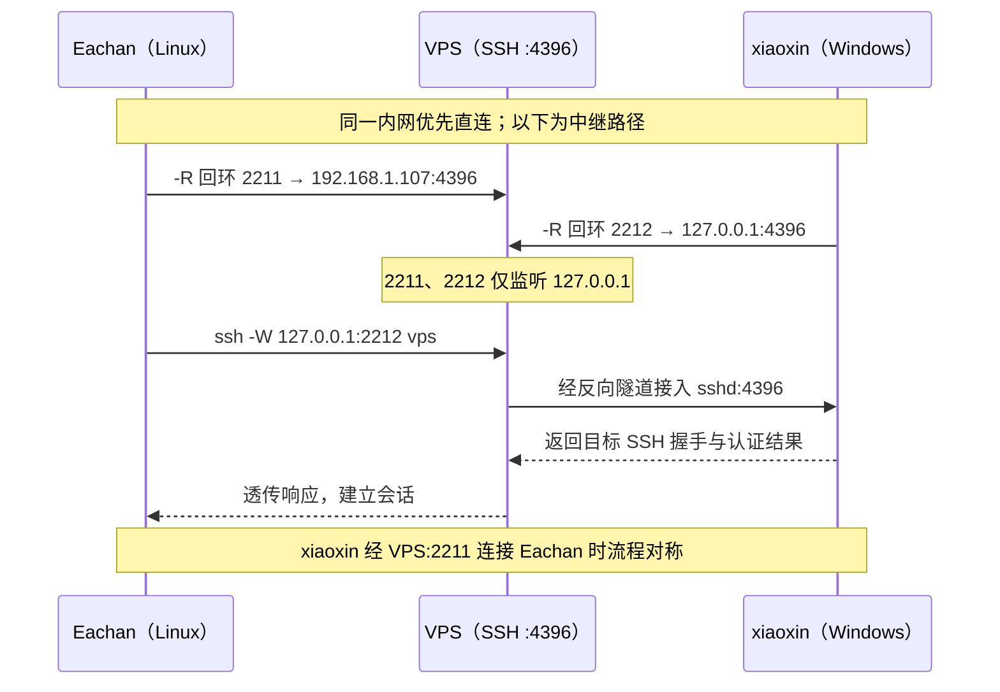

# VPS 中继的双向 SSH 访问方案

Eachan 与 xiaoxin 均可主动访问公网 VPS，却可能因 NAT 或网络切换而无法从外部直接接入。两台主机分别向 VPS 建立反向 SSH 隧道，VPS 将其 SSH 服务映射到仅本机可访问的回环端口；访问方再通过 VPS 的 SSH 连接进入对应端口。客户端保留原有内网地址，并在内网 SSH 端口不可达时选择中继，因此日常仍使用 `ssh xiaoxin` 或 `ssh eachan`。

## 拓扑与连接路径

| 主机 | SSH 服务 | 内网直连地址 | VPS 上的回环入口 |
| --- | --- | --- | --- |
| Eachan（Linux） | `:4396` | `192.168.1.107:4396` | `127.0.0.1:2211` |
| xiaoxin（Windows） | `:4396` | `192.168.1.103:4396` | `127.0.0.1:2212` |
| VPS | `:4396` | `Host vps` 指向公网地址 | 承载两条反向隧道 |



反向转发中的第一个地址是 **VPS 的监听地址**，第二个地址是 **建立隧道的主机所连接的目标服务**。例如，Eachan 的 `-R 127.0.0.1:2211:192.168.1.107:4396` 使 VPS 上的 `2211` 通向 Eachan 的 SSH 服务。两个入口只绑定 VPS 的 `127.0.0.1`，公网防火墙只需放行现有的 VPS SSH 端口 `4396`，两台内网主机无需路由器端口映射。

访问方执行的 `ProxyCommand ssh -W 127.0.0.1:2212 vps` 先登录 VPS，再请求 VPS 连接本机回环端口 `2212`。外层 SSH 会话仍与 xiaoxin 的 `sshd` 握手，主机密钥校验和目标用户认证沿用 `Host xiaoxin` 的配置；反向访问 Eachan 使用端口 `2211`。

## 隧道部署

两台主机均需运行 OpenSSH Server，并能以密钥登录 VPS 的 `vps` 别名；互访所需的目标主机公钥授权也沿用现有配置。VPS 的 `sshd` 需允许 TCP 转发。以下命令中的端口和内网地址对应上表。

### VPS：清理失联会话

网络切换可能让 VPS 暂时保留旧隧道的监听端口。为 `sshd` 配置服务端保活，使无响应的会话在约 90 秒后退出，并释放端口：

```text
# /etc/ssh/sshd_config.d/90-relay-keepalive.conf
ClientAliveInterval 30
ClientAliveCountMax 3
```

```sh
sudo /usr/sbin/sshd -t && sudo systemctl reload ssh
sudo /usr/sbin/sshd -T | grep -E '^(clientaliveinterval|clientalivecountmax) '
```

运行中的隧道在服务重载后重新建立，才会使用新的服务端配置。

### Eachan：用户级 systemd 服务

`~/.config/systemd/user/ssh-relay-eachan.service`：

> - `-N`：不执行远程命令，只建立隧道。
> - `-T`：不分配伪终端，适合后台隧道。
> - `-o BatchMode=yes`：禁止交互式输入密码/确认，认证失败就直接退出，适合 systemd 自动运行。
> - `-o ExitOnForwardFailure=yes`：如果端口转发建立失败，SSH 立即退出，而不是保持一个没有隧道的连接。
> - `-o ServerAliveInterval=20`：每 20 秒向服务器发保活消息。
> - `-o ServerAliveCountMax=3`：连续 3 次保活无响应就断开，约 60 秒判定连接失效。
> - `-R 127.0.0.1:2211:192.168.1.107:4396`：反向转发规则：

```ini
[Unit]
Description=Eachan SSH reverse relay through VPS

[Service]
ExecStart=/usr/bin/ssh -NT -o BatchMode=yes -o ExitOnForwardFailure=yes -o ServerAliveInterval=20 -o ServerAliveCountMax=3 -R 127.0.0.1:2211:192.168.1.107:4396 vps
Restart=always
RestartSec=5

[Install]
WantedBy=default.target
```

```sh
systemctl --user daemon-reload
systemctl --user enable --now ssh-relay-eachan.service
```

这里将目标设为 Eachan 当前提供 sshd侦听端口 `192.168.1.107:4396`。若该主机的内网地址改变，应同步更新服务文件中的转发目标。Eachan 已启用用户 lingering，用户服务可在未保持交互式登录时运行。

### xiaoxin：登录任务

`C:\Users\yceachan\.ssh\relay-tunnel.ps1` 保持一条到 VPS 的连接；`ssh` 退出后等待五秒重试：

```powershell
$ssh = Join-Path $env:WINDIR 'System32\OpenSSH\ssh.exe'
while ($true) {
    & $ssh -NT -o BatchMode=yes -o ExitOnForwardFailure=yes -o ServerAliveInterval=20 -o ServerAliveCountMax=3 -R 127.0.0.1:2212:127.0.0.1:4396 vps
    Start-Sleep -Seconds 5
}
```

用当前 Windows 用户注册登录触发的计划任务 `SSH Relay Xiaoxin`：

```powershell
$ErrorActionPreference = 'Stop'
$user = [System.Security.Principal.WindowsIdentity]::GetCurrent().Name
$script = Join-Path $env:USERPROFILE '.ssh\relay-tunnel.ps1'
$powershell = Join-Path $env:WINDIR 'System32\WindowsPowerShell\v1.0\powershell.exe'
$action = New-ScheduledTaskAction -Execute $powershell -Argument "-NoProfile -ExecutionPolicy Bypass -WindowStyle Hidden -File `"$script`""
$trigger = New-ScheduledTaskTrigger -AtLogOn -User $user
$principal = New-ScheduledTaskPrincipal -UserId $user -LogonType Interactive -RunLevel Limited
$settings = New-ScheduledTaskSettingsSet -ExecutionTimeLimit (New-TimeSpan -Seconds 0) -MultipleInstances IgnoreNew -RestartCount 3 -RestartInterval (New-TimeSpan -Minutes 1) -AllowStartIfOnBatteries -DontStopIfGoingOnBatteries -StartWhenAvailable
Register-ScheduledTask -TaskName 'SSH Relay Xiaoxin' -Action $action -Trigger $trigger -Principal $principal -Settings $settings -Force
Start-ScheduledTask -TaskName 'SSH Relay Xiaoxin'
```

任务在 `yceachan` 登录后启动。锁屏保留登录会话，隧道继续运行；睡眠或网络切换导致连接中断时，脚本在网络恢复后重试。

## 同名别名自动选路

两端原有 `Host` 条目继续指定内网地址、登录用户和端口。`Match !exec` 检查内网 SSH 端口；探测失败时，`ProxyCommand` 让 VPS 连接相应的回环入口。外层 SSH 仍以原 `Host` 条目处理身份和主机密钥。

### Eachan 上访问 xiaoxin

在 `~/.ssh/config` 中保留并补充相关条目；已有 `Host vps` 时沿用现有定义：

```sshconfig
Host xiaoxin
    HostName 192.168.1.103
    User yceachan
    Port 4396

Host vps
    HostName <VPS_IP>
    User pi
    Port 4396

Match originalhost xiaoxin !exec "nc -z -w 1 192.168.1.103 4396"
    ProxyCommand ssh -W 127.0.0.1:2212 vps
```

### xiaoxin 上访问 Eachan

`C:\Users\yceachan\.ssh\probe-eachan.ps1` 在 800 毫秒内探测内网端口：

```powershell
$client = New-Object System.Net.Sockets.TcpClient
try {
    $connection = $client.BeginConnect('192.168.1.107', 4396, $null, $null)
    if (-not $connection.AsyncWaitHandle.WaitOne(800)) { exit 1 }
    $client.EndConnect($connection)
    exit 0
} catch {
    exit 1
} finally {
    $client.Close()
}
```

在 Windows 的 `~/.ssh/config` 中保留并补充：

```sshconfig
Host eachan
    HostName 192.168.1.107
    User pi
    Port 4396
    IdentityFile ~/.ssh/id_ed25519
    IdentitiesOnly yes

Host vps
    HostName <VPS_IP>
    User pi
    Port 4396

Match originalhost eachan !exec "powershell.exe -NoProfile -ExecutionPolicy Bypass -File C:/Users/yceachan/.ssh/probe-eachan.ps1"
    ProxyCommand ssh -W 127.0.0.1:2211 vps
```

## 使用与维护

两台主机在线时，同一局域网内直接使用 `ssh xiaoxin` 或 `ssh eachan`；异地使用相同命令，自动选择 VPS 路径。检查 VPS 上的监听地址：

```sh
ssh vps 'ss -ltn | grep -E ":(2211|2212)[[:space:]]"'
```

预期两端口均监听 `127.0.0.1`。`ExitOnForwardFailure=yes` 使端口占用等建隧道错误直接结束本次连接，由 systemd 或 Windows 脚本重试；客户端 `ServerAlive*` 检测到 VPS 失联后退出，服务端 `ClientAlive*` 清理 VPS 上的旧会话。

若希望各主机的访问权限能够独立撤销，可为 Eachan 和 xiaoxin 分配不同密钥，并分别在 VPS 与目标主机上授权。两台主机共用一把私钥时，任一端密钥泄露都需同步轮换两端的私钥与授权公钥。

## 参考

- [OpenSSH ssh：反向端口转发与 `-W`](https://man.openbsd.org/ssh)
- [OpenSSH ssh_config：`Match` 与 `ProxyCommand`](https://man.openbsd.org/ssh_config)
- [OpenSSH sshd_config：转发限制与服务端保活](https://man.openbsd.org/sshd_config)
- [Microsoft：登录触发的计划任务](https://learn.microsoft.com/en-us/windows/win32/taskschd/starting-an-executable-when-a-user-logs-on)
